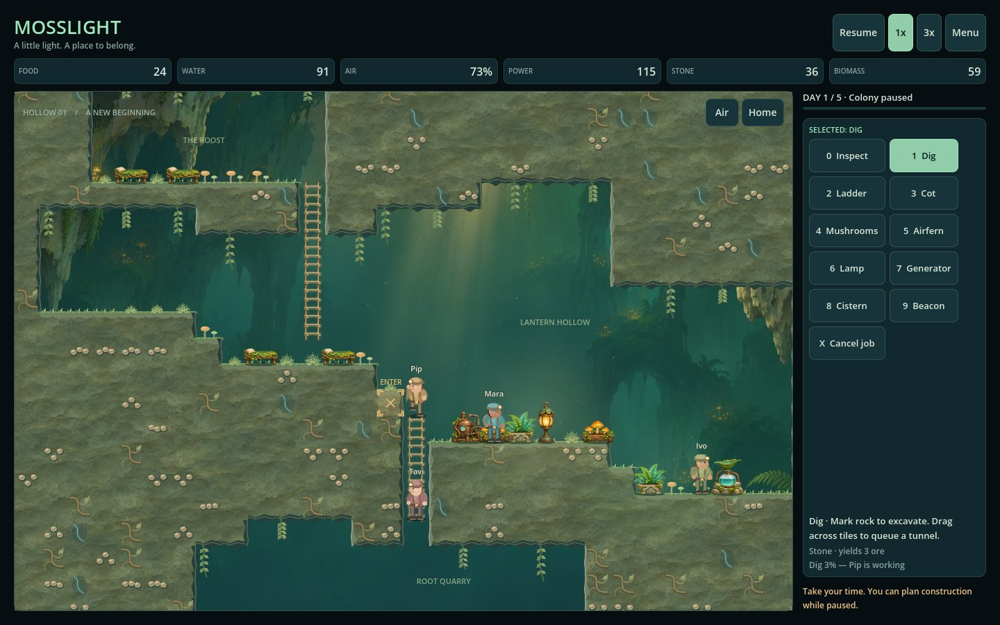

# Mosslight

Mosslight is a small 2D colony survival game set in a pixel-art living cave. Four settlers dig, build, and balance food, water, breathable air, and power. This repository, `yanfengliu/platsim`, is the home of the game.



*Current in-game capture: new mushrooms and an airfern beside the glow lamp, with excavation underway below the colony.*

## Play and edit

Open `mosslight/project.godot` in Godot 4.7.2 (standard GDScript edition), then press F5. The project supports Windows, macOS, and web exports. Native Mac execution has not been tested on this Windows machine. See [setup, controls and exports](mosslight/README.md).

A whole-PC freeze shortly after Windows launch is under investigation. Rendering now has a 60 FPS cap, but the system-freeze cause remains unconfirmed. Headless memory checks and software-rendered gameplay do not certify native GPU stability. See the [native investigation and evidence limits](docs/work/5_native-freeze/plan.md).

Build (B) opens categories, then items with sizes and costs. Beds, machinery and tall equipment occupy appropriately sized multi-tile footprints. Escape opens the pause menu and Settings. UI scaling runs from 100% to 200% where the window has room. Space pauses; 1x/3x controls time. Digging has a two-handed swing, rock impact, recoil, and chips. There are no live-game saves in this prototype.

## Development

Use Node 24.12.0 and set `GODOT_BIN` to the Godot executable, or place `godot` on PATH. Exports need matching Godot export templates; `GODOT_TEMPLATES` can point at an unpacked template folder.

```sh
npm ci --ignore-scripts
npm run check
npm test
npm run build
npm run dev
```

The seven headless Godot suites cover simulation, presentation motion, digging anatomy, UI settings, terrain caching, pixel-art assets, and runtime stability. `npm run build` creates the web export; `npm run dev` serves it at localhost:4180. Stop the server with Ctrl+C. Native exports use `npm run export:windows` and `npm run export:macos`.

The gameplay image stays in step with the game: `npm run check` and CI reject an outdated capture when game source, scenes, settings, or artwork change. [Refresh the image](docs/images/README.md) from a fresh build, inspect it, and commit the image and its manifest with the change. Documentation and test-only edits do not require a new capture.

## Repository contents

- `mosslight/`: Godot project, original artwork, scripts, tests, and portable build helpers.
- `docs/work/`: current work records and preserved historical reviews.
- `output/` and `tmp/`: ignored local builds, tools, captures, evidence, and temporary files. They are not stored in Git.

The repository retains the game's extracted development history. The migration record documents its original commit mapping and verification; current work should use this repository and its own remote.
